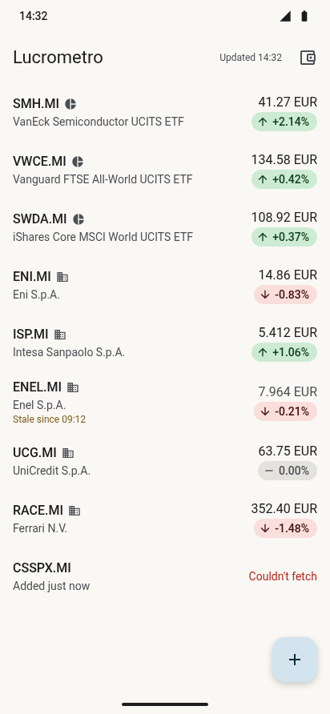
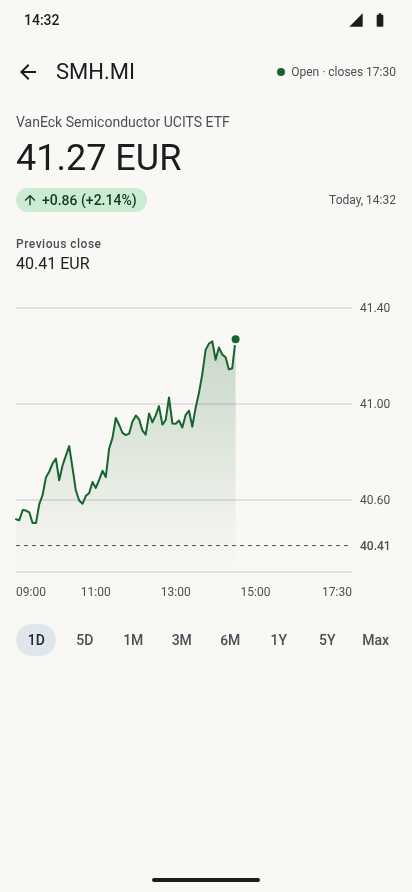

  

# Lucrometro

Android app to glance at 10-15 ETFs and Borsa Italiana stocks. Work in progress.

- A watchlist shows each ticker's last price and today's change.
- Tapping a ticker opens a chart, from today's session back to its full history.
- Data comes free from Yahoo Finance. There is no account and no server: everything stays on the phone.
- When a price can't be fetched, the app says so. It never shows wrong data.

## Design

These are the designs, made before the code. The screens are not built yet.

  
  &nbsp;&nbsp;
  

More in [docs/prd.md](docs/prd.md) (what the app does) and [docs/design/](docs/design/) (how it looks).

Agents: see [CLAUDE.md](CLAUDE.md). License: [AGPL-3.0](LICENSE).
