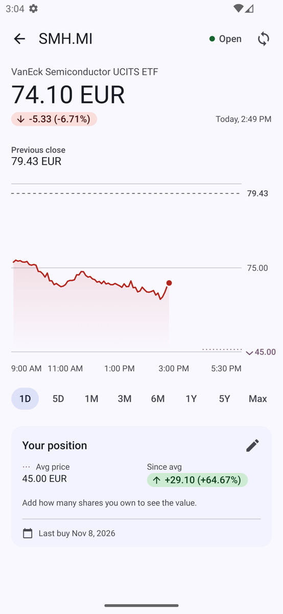

<p align="center">
  
</p>

# Lucrometro

<p>
  <a href="../../releases/latest"></a>
  <a href="../../releases"></a>
  
  <a href="LICENSE"></a>
  <a href="#how-it-was-built"></a>
</p>

An Android app to check a short list of ETFs and Borsa Italiana stocks a few times a day.
It was built entirely by AI coding agents. I made the product and design decisions and directed every step.

<p align="center">
  
  &nbsp;&nbsp;
  
</p>

## What it does

- A watchlist shows each ticker's last price and today's change.
- Tapping a ticker opens its chart, from today's session back to its full history, with a touch scrub.
- Add your average buy price to see how far the price has moved from it, marked on the chart.
- While the market is open, the details screen can check the price every 15 seconds.
- There is no account and no server. Everything stays on the phone.
- When a price can't be fetched, the app says so and shows the last saved quote as stale. It never shows wrong data.
- English and Italian.

See [CHANGELOG.md](CHANGELOG.md) for what changed and the known limitations.

## Install

Lucrometro is not on Google Play. Install the APK by hand (Android 8.0 or later):

1. On the phone, download `lucrometro-<version>.apk` from the [latest release](../../releases/latest).
2. Open it. Android asks to allow installs from the app you opened it with (the browser or the file manager):
   allow it, then install.
3. To update, install the newer APK the same way. Your watchlist and positions are kept.

To be told about new versions, add this repository's URL to [Obtainium](https://github.com/ImranR98/Obtainium),
which installs updates from GitHub releases.

**Check the signature (optional).** Every release is signed with the same key. Its certificate's SHA-256 is:

```
26:AB:73:10:3E:6A:37:0E:8E:AD:F2:2D:A2:D2:5D:46:B8:2B:35:4A:D2:78:A8:81:23:00:65:2E:A3:0F:8C:BC
```

Compare it with `apksigner verify --print-certs lucrometro-<version>.apk` (Android SDK build tools), or with
[AppVerifier](https://github.com/soupslurpr/AppVerifier) on the phone. If it differs, don't install the APK.

## How it was built

All the code, tests, docs and commits were written by Claude Code agents (Opus, Sonnet and Haiku; the
`Co-Authored-By` line on each commit says which one). My part was deciding what to build, how it should look and
behave, and what came next. Agents handled the rest: the typing, wiring, checks and releases. That's where they
add speed.

The loop, and where to see each step in the repo:

1. **Decide what to build.** A short product spec, [docs/prd.md](docs/prd.md), set the scope of v1.
   Each non-obvious choice became a decision record in [docs/decisions/](docs/decisions/), one file per
   decision, superseded but never rewritten. At each release, the decisions are folded into
   [docs/spec.md](docs/spec.md), one page on how the app works now, so agents don't have to replay the history.
2. **Design before code.** Screens were designed in Doop, a design canvas the agents read through MCP, and
   signed off by me. They are snapshotted into [docs/design/doop/](docs/design/doop/), so agents build from
   files in the repo. The [doop-sync skill](.claude/skills/doop-sync/SKILL.md) does the export and the port. The export needs
   access to my Doop canvas, but the port and the build only need the snapshot.
   Rules for a native Material 3 look are in [docs/design/](docs/design/).
3. **Break it down, then build.** Each feature starts with a plan: the agent splits the design and the decisions
   into tasks, and I approve it or change it before any code is written. [CLAUDE.md](CLAUDE.md) gives every agent
   the same stack, commands and conventions. Every change is built, installed on an emulator and checked from a
   screenshot before it counts as done. Choices that only came up while building are written down too, for example
   [0037](docs/decisions/0037-auto-refresh-build-choices.md).
4. **Review, then audit.** Each feature gets an agent code review of its change, and the fixes land as their own
   commit ("Fix the ... review findings"). Every few features, an agent audits the whole codebase, not just the
   latest diff: bugs that only show across features, dead code, and things to merge or delete. Those fixes land
   together too ("Fix the audit findings"). This keeps technical debt from piling up even though no one types the
   code by hand.
5. **Release.** [scripts/release.sh](scripts/release.sh) runs the checks, builds and verifies the signed APK,
   tags it and publishes the GitHub release, all in one command.

Findings from experiments, like how the data source behaves, are in [docs/research/](docs/research/).
What comes next is in [docs/roadmap.md](docs/roadmap.md).

## Stack

Kotlin, Jetpack Compose, Material 3, Room, Cronet. Single module, no own backend.

## Data source

Prices come from Yahoo Finance's public, unofficial endpoints, called directly from the phone. Lucrometro is a
personal project, not affiliated with or endorsed by Yahoo or Borsa Italiana. The endpoints are undocumented and can
change or stop working at any time. Prices for Borsa Italiana are delayed by about 15 minutes, and any price can be
late, wrong or missing.

**Not financial advice.** The app shows prices and what you type in; it does not recommend anything. Check with your
broker before you buy or sell. Use it at your own risk.

## Contributing

Bug reports and ideas are welcome as [issues](../../issues). Please include the app version (in the release name) and
your Android version. Pull requests are not accepted: the code is written by agents from my decisions, so an
outside change doesn't fit that loop. Open an issue instead and I'll take it from there.

## License

[AGPL-3.0](LICENSE).
