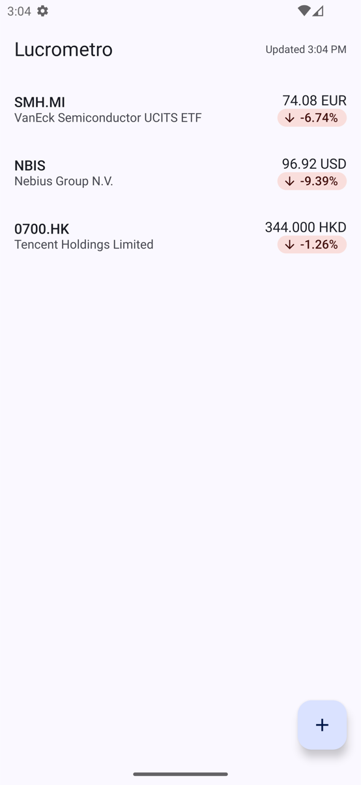

  

# Lucrometro

An Android app to check a short list of ETFs and Borsa Italiana stocks a few times a day.
It was built entirely by AI coding agents. I made the product and design decisions and directed every step.

  
  &nbsp;&nbsp;
  

## What it does

- A watchlist shows each ticker's last price and today's change.
- Tapping a ticker opens its chart, from today's session back to its full history, with a touch scrub.
- Add your average buy price to see how far the price has moved from it, marked on the chart.
- While the market is open, the details screen can check the price every 15 seconds.
- There is no account and no server. Everything stays on the phone.
- When a price can't be fetched, the app says so and shows the last saved quote as stale. It never shows wrong data.
- English and Italian.

Download the APK from [Releases](../../releases). See [CHANGELOG.md](CHANGELOG.md) for what changed and the known limitations.

## How it was built

All the code, tests, docs and commits were written by Claude Code agents (Opus, Sonnet and Haiku; the
`Co-Authored-By` line on each commit says which one). My part was deciding what to build, how it should look and
behave, and what came next. Agents handled the rest: the typing, wiring, checks and releases. That's where they
add speed.

The loop, and where to see each step in the repo:

1. **Decide what to build.** A short product spec, [docs/prd.md](docs/prd.md), set the scope of v1.
   Each non-obvious choice became a decision record in [docs/decisions/](docs/decisions/), one file per
   decision, superseded but never rewritten.
2. **Design before code.** Screens were designed in Doop, a design canvas the agents read through MCP, and
   signed off by me. They are snapshotted into [docs/design/doop/](docs/design/doop/), so agents build from
   files in the repo. The [doop-sync skill](.claude/skills/doop-sync/SKILL.md) does the export and the port. The export needs
   access to my Doop canvas, but the port and the build only need the snapshot.
   Rules for a native Material 3 look are in [docs/design/](docs/design/).
3. **Build and verify.** [CLAUDE.md](CLAUDE.md) gives every agent the same stack, commands and conventions.
   Every change is built, installed on an emulator and checked from a screenshot before it counts as done.
4. **Review.** Features get an agent code review, and the fixes land as their own commit
   ("Fix the ... review findings").
5. **Release.** [scripts/release.sh](scripts/release.sh) runs the checks, builds and verifies the signed APK,
   tags it and publishes the GitHub release, all in one command.

Findings from experiments, like how the data source behaves, are in [docs/research/](docs/research/).
What comes next is in [docs/roadmap.md](docs/roadmap.md).

## Stack

Kotlin, Jetpack Compose, Material 3, Room, Cronet. Single module, no own backend.

## Data source

Prices come from Yahoo Finance's public, unofficial endpoints, called directly from the phone. Lucrometro is a
personal project, not affiliated with or endorsed by Yahoo. The endpoints are undocumented and can change or stop
working at any time. Prices for Borsa Italiana are delayed by about 15 minutes. Not financial advice.

## License

[AGPL-3.0](LICENSE).
